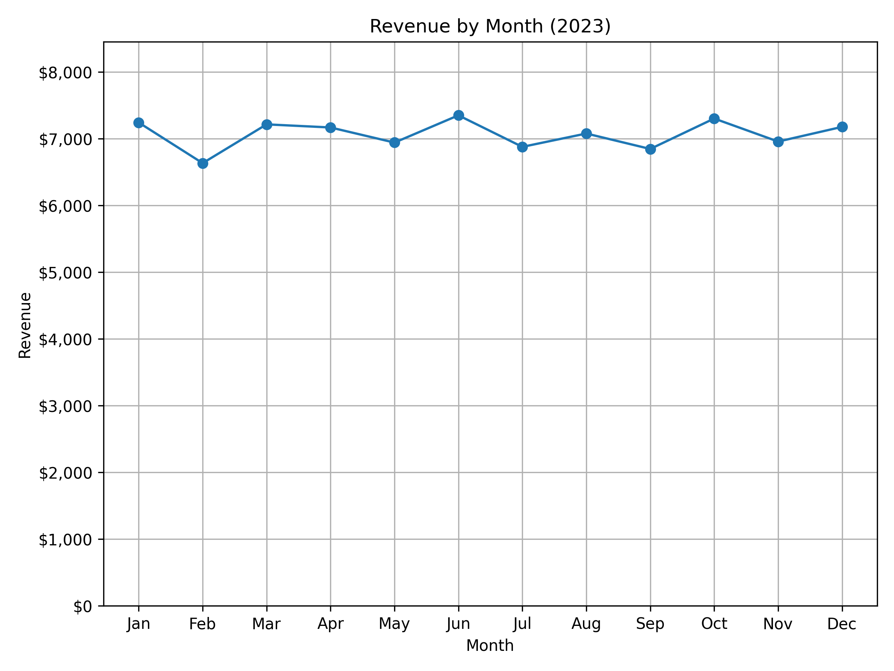
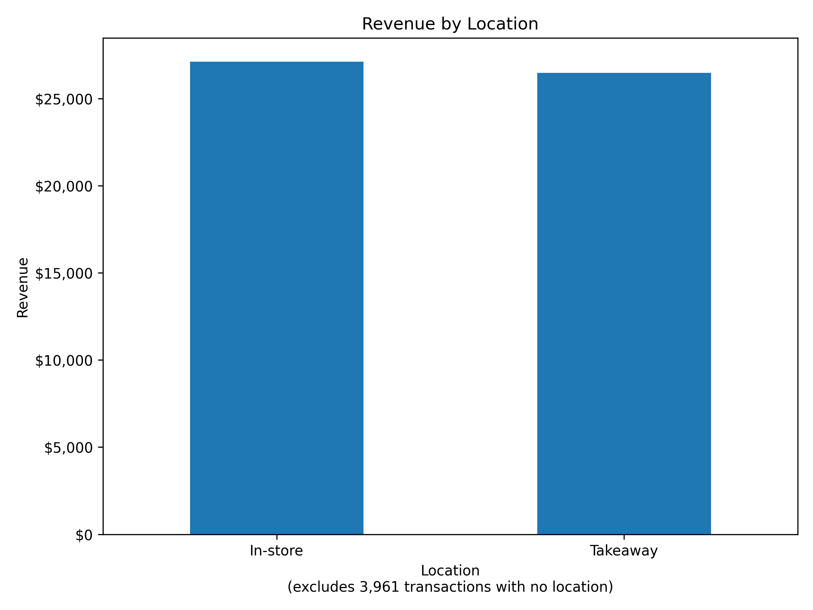
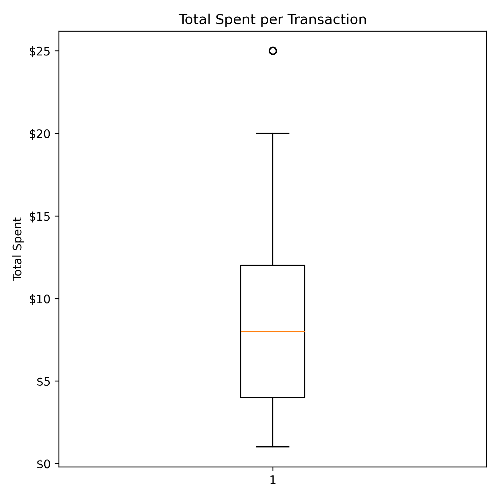
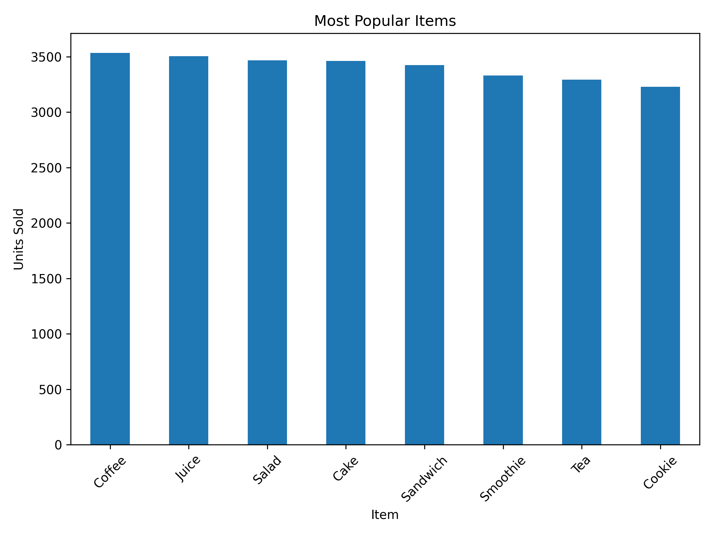
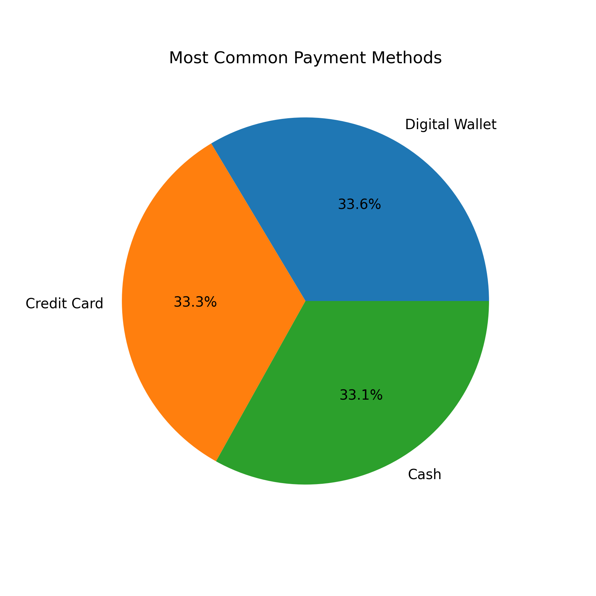

# Cafe Sales Data Cleaning
## Overview
This project demonstrates a cleaning of the 10,000-row 'Cafe Sales' dataset and performs some light business analysis. The dataset, 'Cafe Sales - Dirty Data for Cleaning Training' on Kaggle is a synthetically-messy open dataset by Ahmed Mohamed.

This project aims to:
* Standardize data types and formats.
* Correct or fill erroneous or null entries where possible.
* Remove duplicate entries.
* Enhance table by adding additional columns 

This project uses:
* **DuckDB**
* **Pandas**
* **Matplotlib**

## Setup

### Requirements
* Python 3.12
* `requirements.txt`

### Run Notebook
* Clone repository.
* Run `pip install -r requirements.txt` in a virtual environment.
* Open `cafe_cleaning.ipynb` and run all cells in order. The cleaned dataset is at `data/clean_cafe_sales.csv` and figures will populate `reports/figures`.

## Data Cleaning Report

### Raw Data Issues
* Mixed datatypes.
* Many sentinel NULL values: instances of `ERROR`, `UNKNOWN`, `None`, and blank values that should be NULLs.
* Missing data: various cells missing data across all columns. 

### Cleaning Performed
* Standardize data types.
* Replace instances of `ERROR`, `UNKNOWN`, `None`, and blank values with true NULLs.
* Fill missing `total_spent` from `quantity` and `price_per_unit`.
* Fill missing `quantity` or `price_per_unit` using the other two values, without overwriting existing values.
* Remove any duplicate entries (in this case each entry and primary key is unique).
* Add `transaction_year`, `transaction_month`, and `transaction_day` columns for later analysis.

### Cleaning Outcome
* All datatypes standardized.
* All null values represented by true NULLs (3,256 sentinel values converted).
* Recovered 1,398 values from `quantity`, `price_per_unit`, and `total_spent` calculations.
* Removed 0 duplicate entries.
* Added `transaction_year`, `transaction_month`, and `transaction_day` fields for all entries that have a `transaction_date`.
* Validated consistency: of 8,544 rows with `quantity`, `price_per_unit`, and `total_spent` all present, 0 had a total that disagreed with quantity × price.
* Analysis ready (note that rows with one or more NULLs are retained in this set).

### Missing Values: Raw vs. Clean

| Column           | Missing in raw | Recovered | Missing after cleaning |
| ---------------- | -------------- | --------- | ---------------------- |
| `item`           | 969            | 0         | 969                    |
| `quantity`       | 479            | 441       | 38                     |
| `price_per_unit` | 533            | 495       | 38                     |
| `total_spent`    | 502            | 462       | 40                     |
| `payment_method` | 3,178          | 0         | 3,178                  |
| `location`       | 3,961          | 0         | 3,961                  |
| `transaction_date` | 460          | 0         | 460                    |
| **Total**        | **10,082**     | **1,398** | **8,684**              |

Remaining nulls are cells that can't be derived from other columns, so they were left as NULL instead of guessed. Analyses below exclude rows missing the relevant field.

## Light Analysis
Calendar year: 2023
### Total Revenue
$88,952.00

### Total Revenue by Month
Omits transactions without date. 
| Transaction Month | Revenue |
|-------------------|-------------------|
| January           | $7,242.00            |
| February          | $6,633.50            |
| March             | $7,214.50            |
| April             | $7,168.00            |
| May               | $6,941.50            |
| June              | $7,350.00            |
| July              | $6,877.50            |
| August            | $7,077.50            |
| September         | $6,846.00            |
| October           | $7,302.00            |
| November          | $6,957.00            |
| December          | $7,177.00            |

### Total Revenue by Location
Omits transactions without location.
| Location  | Revenue |
|-----------|---------------------|
| In-store  | $27,127.00          |
| Takeaway  | $26,487.50          |

### Average Spent per Transaction
$8.93

### Most Popular Items by Units Sold
Omits transactions without item.
| Item      | Units Sold |
|-----------|--------------|
| Coffee    | 3,534        |
| Juice     | 3,505        |
| Salad     | 3,468        |
| Cake      | 3,462        |
| Sandwich  | 3,424        |
| Smoothie  | 3,330        |
| Tea       | 3,292        |
| Cookie    | 3,228        |

### Items Sold by Location
Omits transactions without location.
| Location | Salad | Sandwich | Juice | Tea  | Cake | Cookie | Coffee | Smoothie |
| -------- | ----- | -------- | ----- | ---- | ---- | ------ | ------ | -------- | 
| In-store | 1132  | 1127     | 1103  | 1012 | 986  | 972    | 970    | 953      | 
| Takeaway | 1014  | 1049     | 992   | 1014 | 1047 | 1090   | 1091   | 920      | 

### Common Payment Methods by Number of Sales
Omits transactions without payment method.
| Payment Method | Number of Sales |
| -------------- | --------------- |
| Digital Wallet | 2,291           |
| Credit Card    | 2,273           |
| Cash           | 2,258           |

